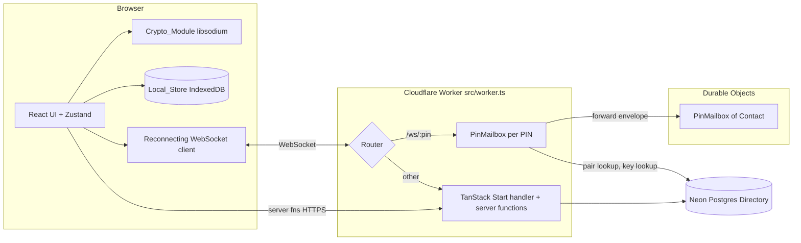
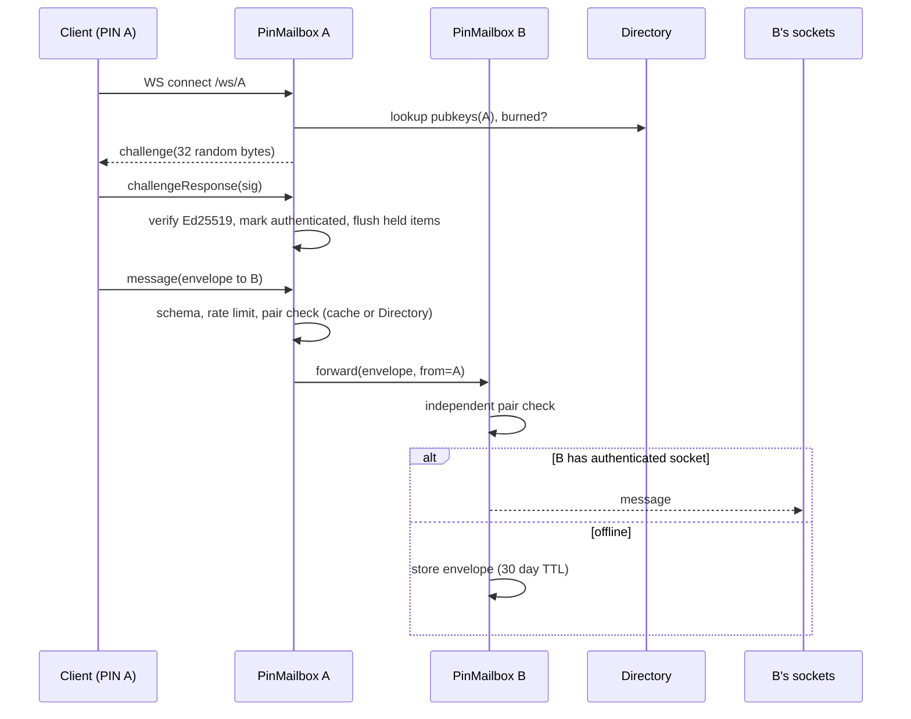
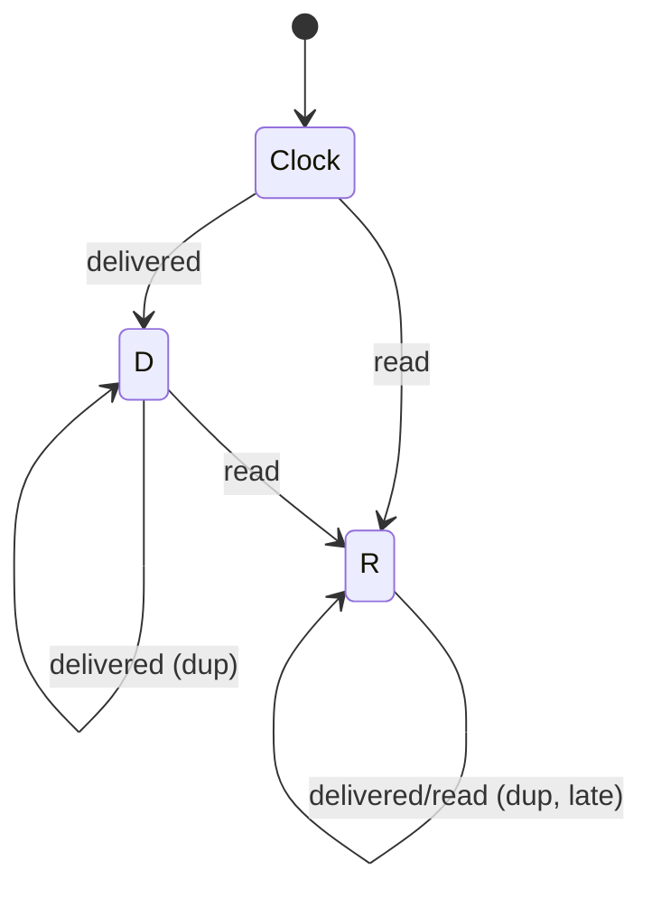
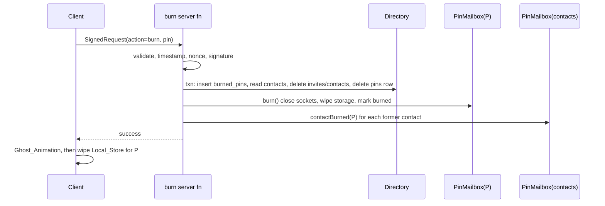

# Design Document

## Overview

PinMe is a BBM-style web messenger where identity is a burnable 8-character hex PIN instead of a phone number. One browser Identity holds up to 20 PINs. Each PIN has its own X25519 (encryption) and Ed25519 (ownership) key pairs, and no server data links PINs of one user. Burning a PIN cuts off every contact who only knew it.

Design goals:

- The server is a public-key directory plus a ciphertext relay. It never sees plaintext or private keys.
- One Cloudflare Worker serves pages, server functions and WebSockets. One `PinMailbox` Durable Object exists per PIN.
- Pure logic (crypto helpers, protocol schemas, marker state machine, rate limiter, signed-request verification, burn logic) lives in small side-effect-free modules so it can be tested with property-based tests.
- The MVP covers Requirements 1-20 and 25. Requirements 21-24 are optional and are not designed here beyond leaving extension points (see "Extension Points").

### Research Summary

Key findings that shape the design:

- **Durable Object Hibernation API**: DOs accept WebSockets with `ctx.acceptWebSocket(ws)` and handle events through the `webSocketMessage`, `webSocketClose` and `webSocketError` handlers. In-memory state is lost on hibernation, so per-connection state (authenticated flag, pending challenge) must be stored with `ws.serializeAttachment()` and rate-limit/cached state must be rebuildable or kept in DO storage. Alarms (`ctx.storage.setAlarm`) provide timers that survive hibernation, which suits the 10 s challenge timeout, 30-day expiry and delete retries. Sources: [Cloudflare WebSockets in Durable Objects](https://developers.cloudflare.com/durable-objects/best-practices/websockets/), [Durable Objects Alarms](https://developers.cloudflare.com/durable-objects/api/alarms/).
- **DO to DO calls**: a PinMailbox forwards to another by obtaining a stub with `env.PIN_MAILBOX.idFromName(pin)` and calling an RPC method or `fetch`. The receiving DO re-verifies the Contact pair itself (Req 16.4).
- **Ed25519 in WebCrypto**: Workers support `crypto.subtle.verify({ name: "Ed25519" }, key, sig, data)` with raw 32-byte public keys imported as `"raw"`. Source: [Workers WebCrypto](https://developers.cloudflare.com/workers/runtime-apis/web-crypto/). The client signs with libsodium `crypto_sign_detached`, which produces standard Ed25519 signatures, so the two verify each other.
- **libsodium-wrappers**: `crypto_box_easy(message, nonce, recipientPk, senderSk)` and `crypto_box_open_easy` give authenticated encryption with a 24-byte nonce (`crypto_box_NONCEBYTES`). Source: [libsodium public-key authenticated encryption](https://libsodium.gitbook.io/doc/public-key_cryptography/authenticated_encryption).
- **Neon + Drizzle on Workers**: use `@neondatabase/serverless` (`neon()` HTTP driver for single queries, `Pool` over WebSocket for transactions) with `drizzle-orm/neon-http` or `neon-serverless`. A fresh client per request is the recommended pattern on Workers. Source: [Drizzle with Neon](https://orm.drizzle.team/docs/get-started/neon-new).
- **TanStack Start on Cloudflare**: a custom Worker entry can wrap the Start handler, which lets `src/worker.ts` intercept `/ws/:pin` and delegate everything else. Server functions are created with `createServerFn`. Source: [TanStack Start hosting](https://tanstack.com/start/latest/docs/framework/react/hosting).

Content was rephrased for compliance with licensing restrictions.

### Key Design Decisions

| Decision | Rationale |
|---|---|
| Contact-pair authority is the Directory (Neon); each PinMailbox caches pairs | Satisfies Req 16 (cache refresh within 5 s, independent re-verification on the receiver, fail closed when Directory is unreachable and cache misses). |
| Cache invalidation by explicit push plus a short TTL | Pair add/remove calls `invalidate` on both mailboxes; a 5 s TTL on cache entries bounds staleness even if the push is lost. |
| Mailbox state in DO storage (SQLite-backed or KV API), per-socket state in attachments | Required for the Hibernation API; nothing important may live only in memory. |
| Message relay is DO to DO, not through the Directory | Directory never holds messages (Req 17.4). |
| Signed requests sign a canonical string, verified with WebCrypto | Deterministic canonicalization makes tamper detection (Req 19.8) testable as a pure function. |
| Nonce replay table in Neon with 120 s retention | Workers are stateless across isolates, so replay state must be shared. |
| Delivery marker as a pure monotonic max over an ordered enum | Makes Req 8.9 and 8.11 a single algebraic property. |
| Client crypto isolated in `src/client/crypto`; storage in `src/client/storage` | Enforced with ESLint `no-restricted-imports` (Req 18.12, 18.13). |

## Architecture



### Source layout

```
src/
  worker.ts              # entry: routes /ws/:pin to PinMailbox, else Start handler; re-exports PinMailbox
  shared/                # Zod protocol schemas, types, constants, pure helpers (pin, marker, canonical)
  durable/               # PinMailbox, EchoDO (hello world), ratelimit, pair cache
  server/                # server functions, signed-request verification, directory service
  db/                    # Drizzle schema, client factory, migrations
  client/
    app/                 # composition root: Local_Store, connection manager, per-session handler wiring
    crypto/              # ONLY place importing libsodium-wrappers
    storage/             # ONLY place importing idb
    net/                 # reconnecting WebSocket (heartbeat, backoff with jitter), sessions, dispatch, frame handlers
    state/               # Zustand stores (connection status is per own PIN)
    chat/ invites/ pins/ profile/ onboarding/ scan/   # feature logic, framework-free
  components/
    app/                 # AppRuntime (boots sockets on every route), toasts
    chat/ contacts/ invites/ pins/ scan/   # feature UI
    ui/                  # shared primitives (Modal)
  routes/                # TanStack routes
```

Dependency rule: `durable`, `server`, `db` must not import from `client`. `shared` imports nothing from the others. Enforced by ESLint `no-restricted-imports` overrides.

### Connection and message flows





### Burn flow



Repeated burn of an already-burned PIN returns success without changes (Req 13.16). The signature check for an already-burned PIN uses the public key retained in `burned_pins` (see Data Models), so the idempotent call still requires ownership proof; Req 19.7 ("PIN already burned" rejected) is reconciled by treating a *burn* action on a burned PIN as a no-op success and all other actions as rejected.

## Components and Interfaces

### Shared protocol (`src/shared/protocol.ts`)

All schemas are defined once with Zod and imported by both sides. The union is discriminated on `type` and covers exactly: `challenge`, `challengeResponse`, `message`, `delivered`, `read`, `typing`, `ping`, `broadcast`, `inviteNotice`, `contactBurned`, `error`.

```ts
export const PinSchema = z.string().regex(/^[0-9A-F]{8}$/);
export const MessageIdSchema = z.string().uuid();
const b64 = z.string().regex(/^[A-Za-z0-9+/_-]+={0,2}$/);

export const EnvelopeSchema = z.object({
  to: PinSchema,
  messageId: MessageIdSchema,
  nonce: b64.refine(n => decodedLength(n) === 24),
  ciphertext: b64.refine(c => decodedLength(c) <= 8192), // 8192 accepted, 8193 rejected
});

export const ServerMsg = z.discriminatedUnion("type", [
  z.object({ type: z.literal("challenge"), challenge: b64 /* 32 bytes */ }),
  z.object({ type: z.literal("message"), from: PinSchema, envelope: EnvelopeSchema }),
  z.object({ type: z.literal("delivered"), from: PinSchema, messageId: MessageIdSchema }),
  z.object({ type: z.literal("read"), from: PinSchema, messageId: MessageIdSchema }),
  z.object({ type: z.literal("typing"), from: PinSchema }),
  z.object({ type: z.literal("ping"), from: PinSchema }),
  z.object({ type: z.literal("inviteNotice"), kind: z.enum(["invite", "accepted", "presence"]),
            from: PinSchema, inviteId: z.string().uuid().optional(),
            status: z.enum(["available", "busy"]).optional(), personalMessage: z.string().max(80).optional() }),
  z.object({ type: z.literal("contactBurned"), pin: PinSchema }),
  z.object({ type: z.literal("error"), code: ErrorCode, ref: z.string().optional(),
            field: z.string().optional(), retryAfterSec: z.number().int().optional() }),
]);
// Client-to-server: challengeResponse, message, broadcast (<=100 envelopes), delivered, read, typing, ping.
```

Note on Req 15.7: the protocol set is exactly the eleven listed types. Invite, acceptance and presence pushes (Req 4.2, 4.4, 11.6) all travel as `inviteNotice` with a `kind` field of `invite`, `accepted` or `presence`, so no twelfth type is needed.

Helper pure modules in `src/shared`:

- `pin.ts`: `isValidPin`, `generatePin(randomBytes)`, `PIN_REGEX`.
- `marker.ts`: `type Marker = "clock" | "D" | "R"`; `advance(current, incoming): Marker` returns the max by order clock < D < R.
- `canonical.ts`: `canonicalize(req: {pin, action, ts, nonce, payload}): Uint8Array` deterministic encoding (length-prefixed fields, fixed order, domain-separation prefix `"pinme/v1"`).
- `limits.ts`: constants (4096, 8192, 100, 30 per 10 s, ping 10 s, 10 invites per 60 min, 60 s skew, 120 s nonce window, 20 PINs).

### Crypto_Module (`src/client/crypto`)

```ts
interface CryptoModule {
  ready(): Promise<void>;
  generatePinKeys(): { box: KeyPair; sign: KeyPair };           // unique per PIN
  encrypt(plain: string, recipientBoxPk: Uint8Array, senderBoxSk: Uint8Array): { nonce: Uint8Array; ciphertext: Uint8Array };
  decrypt(env: {nonce; ciphertext}, senderBoxPk, recipientBoxSk): string | null; // null on failure
  signChallenge(challenge: Uint8Array, signSk: Uint8Array): Uint8Array;
  signRequest(req: SignedRequestFields, signSk: Uint8Array): Uint8Array;
  randomBytes(n: number): Uint8Array;
}
```

Encryption uses `crypto_box_easy` with a fresh `randombytes_buf(24)` nonce per call. `decrypt` catches libsodium errors and returns `null`.

### Local_Store (`src/client/storage`)

idb database `pinme` with object stores described in Data Models. Exposes typed repositories: `identityRepo`, `pinRepo`, `contactRepo`, `messageRepo`. Burn cleanup is a single readwrite transaction across stores so a PIN's keys, contacts and conversations disappear atomically. Registration failure and 5-retry exhaustion never write to the store (the PIN is persisted only after a successful registration response).

### Reconnecting WebSocket (`src/client/net/socket.ts`)

Wraps native `WebSocket`. Backoff function (pure): `nextDelay(prev) = min(prev * 2, 30000)` starting at 1000; reset to 1000 after a successful authentication. On every open it waits for `challenge`, signs, and sends `challengeResponse`. Incoming frames are `JSON.parse`d then validated with `ServerMsg`; failures are discarded and logged with only type and field name.

### Client state (`src/client/state`)

Zustand stores: `useIdentityStore`, `usePinsStore`, `useContactsStore`, `useChatStore` (messages, markers, typing), `useConnectionStore`. Stores hydrate from Local_Store and write through. Message handling pipeline: validate, decrypt, persist, update store, emit `delivered`, and `read` when visible.

### PinMailbox Durable Object (`src/durable/PinMailbox.ts`)

Uses `ctx.acceptWebSocket`. Per-socket attachment: `{ authenticated: boolean, challenge: string, challengeExpiresAt: number }`.

Responsibilities and handlers:

- `fetch(req)`: upgrade request. Looks up the PIN in the Directory. If unregistered or burned: accept the socket, send `error(pin_unavailable)`, close, no challenge. Otherwise generate 32 random bytes, store in attachment, send `challenge`, set alarm for +10 s.
- `webSocketMessage(ws, data)`: parse JSON, validate by type. If unauthenticated, ignore everything but `challengeResponse`. Dispatch to `onChallengeResponse`, `onMessage`, `onBroadcast`, `onReceipt` (delivered/read), `onTyping`, `onPing`.
- `alarm()`: close unauthenticated sockets past their deadline; delete stored envelopes older than 30 days; retry failed deletions (max 3, 5 s apart); reschedule.
- RPC methods called by other objects or by server functions: `deliver(item)` (from another mailbox), `invalidatePairs()`, `pushNotice(notice)` (invite, accepted, presence), `burn()`, `contactBurned(pin)`.

Internal pure/semipure helpers:

- `RateLimiter` (sliding window, pure given a clock): `allow(key, now, limit, windowMs) -> {ok, retryAfterMs}`. Messages: 30 / 10 s per sender PIN. Ping: 1 / 10 s per (sender, contact). Invites: 10 / 60 min per sender PIN. Counters are persisted in DO storage so hibernation does not reset them.
- `PairCache`: `Map<otherPin, {accepted: boolean, fetchedAt}>` with 5 s TTL; `invalidate()` clears it. On miss, query the Directory; if the Directory is unreachable and no cache entry exists, return `verification_unavailable` and drop the item (Req 16.5). A removed pair is evicted by `invalidatePairs()` and by TTL, so it is never honored after removal is processed (Req 16.6).
- `Outbox`: stored envelopes keyed `env:{ts}:{messageId}`; on authenticated connect they are sent then deleted. Delete failures schedule retries without re-sending (a `delivered-pending-delete` marker set records that the item has already been sent).
- Held notices: `contactBurned`, `inviteNotice` and presence are stored under `notice:*` and flushed after authentication.

Broadcast handling: reject whole message if more than 100 envelopes; otherwise process envelopes in order. For each: pair check, rate-limit check. Rate-limit rejection stops the loop and every remaining Message_ID is reported as rejected. Non-contact envelopes yield a per-envelope error and processing continues.

### Server functions (`src/server`)

Each uses `createServerFn` with a Zod input validator from `src/shared`. A request guard first rejects bodies containing keys matching `/priv|secret/i` with `private_key_not_accepted`, before any persistence or logging.

| Function | Auth | Effect |
|---|---|---|
| `registerPin` | none (public keys only) | insert into `pins`; reject on existing active or burned PIN |
| `getPublicProfile` | none | return public keys, display name, status for an existing PIN |
| `sendInvite` | Signed_Request | checks (format, exists, burned, self, duplicate), insert `invites`, notify mailbox; rate limit enforced by the sender's PinMailbox via RPC |
| `respondInvite` | Signed_Request | accept: insert `contacts` (canonical ordered pair), delete invite, invalidate both mailboxes, push `accepted`; decline: delete invite |
| `updateProfile` | Signed_Request | status, personal message, display name; push presence to contact mailboxes |
| `burnPin` | Signed_Request | see burn flow |

`verifySignedRequest(req, deps)` order of checks: shape, PIN exists/not burned (burn on burned is the no-op exception), timestamp within ±60 s, nonce unused in 120 s window, Ed25519 verify over `canonicalize(req)`. Nonce is recorded only after all other checks pass, atomically via `INSERT ... ON CONFLICT DO NOTHING` so concurrent replays lose. Error categories: `invalid_signature`, `expired_timestamp`, `replay`, `unknown_pin`.

Invites: the invite sender must prove ownership of its own PIN, which is why `sendInvite` takes a Signed_Request. The invite rate limit lives in the sender's PinMailbox (Req 4.13); `sendInvite` calls `mailbox.checkInviteQuota()` first.

### Worker entry (`src/worker.ts`)

```ts
export { PinMailbox } from "./durable/PinMailbox";
export { EchoDO } from "./durable/EchoDO";
export default {
  async fetch(req, env, ctx) {
    const m = new URL(req.url).pathname.match(/^\/ws\/([0-9A-F]{8})$/);
    if (m && req.headers.get("Upgrade") === "websocket")
      return env.PIN_MAILBOX.get(env.PIN_MAILBOX.idFromName(m[1])).fetch(req);
    if (new URL(req.url).pathname === "/ws-echo") return env.ECHO.get(env.ECHO.idFromName("echo")).fetch(req);
    return startHandler.fetch(req, env, ctx);
  },
};
```

`EchoDO` is the hello-world echo used first to prove realtime (Req 18.15).

### UI routes

`/` home (contacts list, pending invites), `/chat/$pin`, `/pins` (PIN manager, burn dialog, barcode detail), `/add` (add contact, scanner). Unknown chat PIN renders a not-found panel with a link home. Barcode generation uses `qrcode`; scanning uses `html5-qrcode` (one library each). Dark theme with blue accents is defined as Tailwind tokens chosen to meet 4.5:1 contrast. Ghost_Animation is a CSS/Framer-free keyframe animation honoring `prefers-reduced-motion`.

## Data Models

### Directory (Neon, Drizzle) in `src/db/schema.ts`

```ts
export const pins = pgTable("pins", {
  pin: char("pin", { length: 8 }).primaryKey(),
  boxPublicKey: text("box_public_key").notNull(),     // X25519, base64
  signPublicKey: text("sign_public_key").notNull(),   // Ed25519, base64
  displayName: varchar("display_name", { length: 32 }).notNull(),
  status: text("status", { enum: ["available", "busy"] }).notNull().default("available"),
  personalMessage: varchar("personal_message", { length: 80 }).notNull().default(""),
  createdAt: timestamp("created_at").defaultNow().notNull(),
});

export const burnedPins = pgTable("burned_pins", {
  pin: char("pin", { length: 8 }).primaryKey(),
  signPublicKey: text("sign_public_key").notNull(), // retained only to authenticate idempotent re-burns
  burnedAt: timestamp("burned_at").defaultNow().notNull(),
});

export const invites = pgTable("invites", {
  id: uuid("id").primaryKey().defaultRandom(),
  fromPin: char("from_pin", { length: 8 }).notNull(),
  toPin: char("to_pin", { length: 8 }).notNull(),
  createdAt: timestamp("created_at").defaultNow().notNull(),
}, t => [uniqueIndex("invites_pair").on(least(t.fromPin, t.toPin), greatest(t.fromPin, t.toPin))]);

export const contacts = pgTable("contacts", {
  pinLow: char("pin_low", { length: 8 }).notNull(),
  pinHigh: char("pin_high", { length: 8 }).notNull(),
  createdAt: timestamp("created_at").defaultNow().notNull(),
}, t => [primaryKey({ columns: [t.pinLow, t.pinHigh] }), check("ordered", sql`${t.pinLow} < ${t.pinHigh}`)]);

export const usedNonces = pgTable("used_nonces", {   // operational table for Req 19.5/19.9
  pin: char("pin", { length: 8 }).notNull(),
  nonce: text("nonce").notNull(),
  usedAt: timestamp("used_at").defaultNow().notNull(),
}, t => [primaryKey({ columns: [t.pin, t.nonce] })]);
```

Notes:

- Req 18.11 names tables `pins`, `invites`, `contacts`, `burned_pins`. `used_nonces` is an additional operational table needed for replay protection; it holds only a PIN, a random nonce and a time, rows older than 120 s are purged opportunistically, and it contains nothing that links PINs.
- Req 17.2 lists what the Directory may store. `burned_pins.sign_public_key` is a public key, so it is within "public keys", and it is needed to authenticate re-burn idempotently.
- No column references another PIN of the same owner, so Req 2.9 holds structurally.
- A burn transaction: insert `burned_pins` (copying the key), delete the `pins` row, delete `invites` and `contacts` involving the PIN.
- Burned PINs can never be registered because `registerPin` checks both tables and the burned insert is permanent (Req 13.14).
- Contacts are stored as an ordered pair so a pair has exactly one row regardless of direction.

### PinMailbox storage (DO storage)

| Key | Value |
|---|---|
| `env:{isoTs}:{messageId}` | `{ from, envelope, storedAt, sentToSocket?: boolean }` |
| `notice:{seq}` | queued `inviteNotice` or `contactBurned` item |
| `rl:msg`, `rl:invite`, `rl:ping:{peer}` | arrays of timestamps for sliding windows |
| `meta:burned` | boolean tombstone, set by `burn()` |

### Local_Store (IndexedDB via idb)

| Store | Key | Value |
|---|---|---|
| `identity` | `"me"` | `{ displayName, picture?: Blob (<=256KB) }` |
| `pins` | `pin` | `{ pin, label, boxSk, boxPk, signSk, signPk, status, personalMessage, createdAt }` |
| `contacts` | `[ownPin, contactPin]` | `{ ownPin, contactPin, displayName, picture?, boxPk, signPk, status, personalMessage, unavailable: boolean }` |
| `invites` | `inviteId` | `{ ownPin, fromPin, createdAt }` |
| `messages` | `[ownPin, contactPin, messageId]` | `{ direction, text, ts, marker?: "clock"\|"D"\|"R", kind: "chat"\|"broadcast" }` index on `[ownPin, contactPin, ts]` |

Private keys never leave this store and are never part of a network payload type (no schema has a field of that kind).

### Signed_Request

```ts
interface SignedRequest {
  pin: string; action: "burn" | "updateProfile" | "sendInvite" | "respondInvite";
  ts: number;            // ms since epoch
  nonce: string;         // base64, >= 16 bytes
  payload: unknown;      // action-specific, included in canonical bytes
  signature: string;     // Ed25519 over canonicalize({pin, action, ts, nonce, payload})
}
```

The payload is part of the signed bytes, so modifying any field after signing invalidates the signature.

## Correctness Properties

*A property is a characteristic or behavior that should hold true across all valid executions of a system-essentially, a formal statement about what the system should do. Properties serve as the bridge between human-readable specifications and machine-verifiable correctness guarantees.*


Reflection note: the prework produced many near-duplicates, which were consolidated. Marker transitions (8.1-8.5, 8.9, 8.11, 12.5) became one monotonic-reducer property. Every contacts-only criterion (7.9, 8.7, 8.8, 9.7, 10.6, 16.1, 16.3) became one relay-gate property. Signed-request criteria (11.3-11.5, 13.12, 19.3-19.9) became two properties (verification outcome, tamper detection). Burn directory effects (13.4, 13.6, 13.15) merged into one property, with idempotence kept separate. Rate limit criteria (4.13, 7.10, 9.4, 9.5, 12.7) share one sliding-window property parameterized by limit and window. PIN and label/name validators each became one property.

### Property 1: PIN generation format

For any byte source, a generated PIN is exactly 8 characters, each in 0-9 or A-F, and `isValidPin` accepts it. For any string, `isValidPin` accepts it if and only if it matches `^[0-9A-F]{8}$`.

**Validates: Requirements 2.1, 4.7**

### Property 2: Per-PIN key uniqueness

For any set of N generated PINs, the X25519 and Ed25519 key pairs are pairwise distinct and no key is shared between two PINs.

**Validates: Requirements 2.2**

### Property 3: Text field validation

For any string, the display name validator accepts it iff its trimmed form is non-empty and its length is at most 32; the PIN_Label validator accepts it iff trimmed form is non-empty and length is at most 24; the Personal_Message validator accepts it iff length is at most 80. A rejected input leaves the Local_Store or Directory unchanged.

**Validates: Requirements 1.2, 1.5, 3.3, 11.2, 11.9**

### Property 4: Registration validity and collision safety

For any registration input and any Directory state, registration succeeds iff the input is well formed and the PIN is in neither `pins` nor `burned_pins`; on any failure the Directory is unchanged.

**Validates: Requirements 2.3, 2.4, 2.7, 13.14**

### Property 5: Registration retry bound

For any number k of consecutive collisions, the client performs min(k, 5) + 1 attempts at most, stores the PIN iff some attempt among the first 6 succeeds, and stores no PIN or key when all 6 collide.

**Validates: Requirements 2.5, 2.6**

### Property 6: PIN count limit

For any number of Active_PINs c in 0..20, creating a PIN succeeds iff c < 20, and a rejected creation leaves the existing PINs unchanged.

**Validates: Requirements 3.1, 3.4**

### Property 7: Invite decision and state transitions

For any Directory state and any (sender, target) PIN pair, `sendInvite` creates an Invite iff the target exists, is not burned, differs from the sender, and no pending Invite or Contact pair exists in either direction; otherwise it returns the matching error and leaves state unchanged. Accepting a pending Invite results in exactly one Contact pair and no Invite; declining results in no Invite and no pair.

**Validates: Requirements 4.1, 4.4, 4.5, 4.8, 4.9, 4.10, 4.11**

### Property 8: Sliding-window rate limiter

For any sequence of timestamped attempts and any (limit, window) configuration, the limiter allows an attempt iff fewer than `limit` allowed attempts fall in the preceding window, matches a naive reference implementation, and reports `retryAfter` as the time until the oldest in-window attempt expires. Configurations: messages 30 per 10 s, pings 1 per 10 s per contact, invites 10 per 60 min.

**Validates: Requirements 4.13, 7.10, 9.4, 9.5, 12.7**

### Property 9: Scan classification

For any decoded string and any set of own PINs, the scan classifier returns `accept` iff the string is a valid PIN and not an own PIN, `own-pin` iff it is a valid own PIN, and `invalid` otherwise.

**Validates: Requirements 5.3, 5.5, 5.7**

### Property 10: Barcode round trip

For any valid PIN, encoding it into a Barcode and decoding the Barcode yields the original PIN.

**Validates: Requirements 5.6**

### Property 11: WebSocket routing

For any request path, `routeFor(path)` selects the PinMailbox of PIN p iff the path equals `/ws/p` with p valid; every other path is routed to the TanStack Start handler.

**Validates: Requirements 6.2, 18.3, 18.4**

### Property 12: Challenge uniqueness and size

For any number of generated challenges, each has exactly 32 bytes and no two are equal.

**Validates: Requirements 6.3**

### Property 13: Challenge signature verification

For any key pair and challenge, verifying a signature made by the matching private key over that challenge succeeds; verifying with a different challenge, a modified signature or a different public key fails and the connection stays unauthenticated.

**Validates: Requirements 6.4, 6.5, 6.6**

### Property 14: Unauthenticated sockets are inert

For any mailbox state and any message that is not a valid `challengeResponse` arriving on an unauthenticated socket, no state changes, nothing is forwarded, and no stored or live messages are sent on that socket.

**Validates: Requirements 6.8**

### Property 15: Reconnect backoff

For any number n of consecutive failures, the delay before attempt n+1 is min(1000 * 2^n, 30000) ms; after a successful authentication the next delay is 1000 ms.

**Validates: Requirements 6.10, 6.11, 18.17**

### Property 16: Encryption round trip

For any plaintext of 1 to 4096 characters and any pair of key pairs, decrypting the ciphertext produced for the recipient with the matching keys returns the original plaintext.

**Validates: Requirements 7.1, 7.7, 7.12**

### Property 17: Nonce freshness

For any key pair and plaintext, encrypting twice yields different 24-byte nonces.

**Validates: Requirements 7.13**

### Property 18: Failed decryption leaves no trace

For any valid ciphertext with at least one byte altered, or decrypted with a wrong key, `decrypt` returns null, and the receive pipeline writes nothing to the Local_Store and adds nothing to the conversation.

**Validates: Requirements 7.8**

### Property 19: Mailbox store-and-forward

For any sequence of events (recipient connects, authenticates, disconnects; envelopes arrive) the mailbox delivers each envelope to all authenticated sockets if any exist, otherwise stores it; every stored envelope is delivered exactly once on the next authentication and then deleted from storage; ephemeral items (ping, typing) are never stored.

**Validates: Requirements 7.4, 7.5, 7.6, 9.8, 10.7, 17.5**

### Property 20: Contacts-only relay gate

For any pair state and any relayable item (message, delivered, read, typing, ping, broadcast envelope), the mailbox relays the item iff sender and recipient are an accepted Contact pair, as verified independently by the receiving mailbox; otherwise it drops the item, stores nothing, and returns a not-a-contact error to the sender.

**Validates: Requirements 7.3, 7.9, 8.7, 8.8, 9.7, 10.6, 16.1, 16.3, 16.4**

### Property 21: Pair removal takes effect

For any sequence of pair additions, removals and relay attempts, no item received after a removal has been processed is relayed for that pair, including when the pair was cached; and when the Directory is unreachable and the pair is not cached, the item is dropped with a verification error.

**Validates: Requirements 16.2, 16.5, 16.6**

### Property 22: Delivery marker monotonicity

For any sequence of `delivered` and `read` events (including duplicates and any order) applied to a sent message, the marker never decreases in the order clock < D < R and the final marker equals the highest event received (R if any read, else D if any delivered, else clock). Events for an unknown Message_ID change nothing.

**Validates: Requirements 8.1, 8.3, 8.5, 8.9, 8.10, 8.11, 12.5**

### Property 23: Typing throttle

For any sequence of keystroke timestamps in a conversation, the number of typing messages sent in any 3-second interval is at most 1, and none are sent while the input is empty or after sending.

**Validates: Requirements 10.1, 10.2**

### Property 24: Typing indicator visibility

For any sequence of typing events, message arrivals and clock ticks, the Typing_Indicator is visible iff a typing event occurred within the previous 5 seconds with no message from that Contact since.

**Validates: Requirements 10.3, 10.4, 10.5**

### Property 25: Presence retention

For any sequence of presence updates pushed while a Contact has no connected socket, on next authentication the Contact receives the latest status and Personal_Message only.

**Validates: Requirements 11.6, 11.7**

### Property 26: Broadcast construction

For any set of 1 to 100 accepted Contacts, a Broadcast contains exactly one envelope per Contact, with pairwise distinct Message_IDs and distinct nonces, and each envelope decrypts to the plaintext only with its own Contact's key.

**Validates: Requirements 12.1, 12.2**

### Property 27: Broadcast processing

For any broadcast of envelopes, contact set and limiter state: if there are more than 100 envelopes nothing is forwarded; otherwise envelopes are processed in order, non-contact envelopes are rejected individually with processing continuing, and the first rate-limited envelope plus all later ones are rejected while earlier accepted ones are forwarded. Each rejection identifies its recipient PIN and Message_ID.

**Validates: Requirements 12.3, 12.6, 12.8, 12.10**

### Property 28: Burn directory effects

For any Directory state and any active PIN P, after a valid burn: P is in `burned_pins` and not in `pins`; no Invite or Contact pair involves P; every other PIN row and every pair or invite not involving P is unchanged; and each former Contact of P is scheduled to receive exactly one `contactBurned` for P.

**Validates: Requirements 13.4, 13.6, 13.9, 13.15**

### Property 29: Burn idempotence

For any Directory state, burning a PIN twice produces the same state as burning it once, and the second call returns success.

**Validates: Requirements 13.16**

### Property 30: Burned PIN is unreachable

For any burned PIN, registration, invites to it, messages to it, and new connections for it are all rejected with the burned/unavailable error, and its mailbox holds no queued data.

**Validates: Requirements 13.5, 13.11, 13.14**

### Property 31: Local burn cleanup is scoped

For any Local_Store with several PINs, cleaning up burned PIN P removes all keys, Contacts, invites and messages for P and leaves all data of other PINs unchanged.

**Validates: Requirements 13.8**

### Property 32: Contact marked unavailable on burn

For any chat state and `contactBurned(P)` event, the chat with P is marked unavailable, sending to it is rejected, and no message is added.

**Validates: Requirements 13.10, 25.5**

### Property 33: Protocol validation discards bad input

For any arbitrary string or JSON value delivered as a WebSocket frame, the receiver either parses it as exactly one of the eleven types or discards it; on discard the state is unchanged and the reported error contains only the message type and failed field name, not content. A message with ciphertext of 8192 bytes is accepted and 8193 bytes is rejected.

**Validates: Requirements 15.2, 15.3, 15.4, 15.5, 15.6, 15.8**

### Property 34: Protocol round trip

For any valid protocol message, `ServerMsg.parse(JSON.parse(JSON.stringify(m)))` deep-equals `m`.

**Validates: Requirements 15.9**

### Property 35: Private key fields rejected

For any request body containing, at any depth, a key named like `privateKey` or `secretKey`, the server rejects it with `private_key_not_accepted`, persists nothing, and the log output contains no part of the payload.

**Validates: Requirements 17.6, 17.3**

### Property 36: Envelope expiry and deletion retry

For any set of stored envelopes with random ages, the purge removes exactly those older than 30 days; for any deletion that fails k times, the mailbox retries at most 3 times and never re-delivers the envelope.

**Validates: Requirements 17.7, 17.8**

### Property 37: Signed request verification outcome

For any request, server clock, nonce history and PIN state: the request is accepted iff the PIN is active with a registered key, the timestamp is within 60 seconds of server time, the nonce was not used for that PIN in the previous 120 seconds, and the Ed25519 signature over the canonical bytes verifies. Otherwise it is rejected with the category `unknown_pin`, `expired_timestamp`, `replay` or `invalid_signature` and stored data is unchanged. An accepted nonce is recorded for at least 120 seconds.

**Validates: Requirements 11.3, 11.4, 11.5, 13.12, 19.3, 19.4, 19.5, 19.6, 19.7, 19.9**

### Property 38: Tamper detection

For any validly signed request, changing any one of PIN, action, timestamp, nonce or payload after signing causes verification to fail.

**Validates: Requirements 19.8**

### Property 39: Canonical encoding injectivity

For any two distinct requests (differing in at least one field), their canonical byte encodings differ, and encoding the same request twice gives identical bytes.

**Validates: Requirements 19.2, 19.8**

## Error Handling

All errors use the protocol `error` message (WebSocket) or a typed `PinMeError` result (server functions) with a stable `code`. Messages carry only the code, optional `ref` (Message_ID or message type), optional `field`, and optional `retryAfterSec`. Content, ciphertext and keys are never included or logged.

| Code | Raised when | Client behavior |
|---|---|---|
| `validation_failed` | schema failure (15.5, 15.6) | message discarded; dev log with type and field only |
| `pin_unavailable` | connect to burned or unknown PIN (6.9) | stop reconnecting for that PIN |
| `not_a_contact` | relay gate fails (7.9, 16.3) | show failure on message, no retry |
| `rate_limited` | limiter denies (4.13, 7.10, 9.5, 12.8) | show wait time; PING button disabled for `retryAfterSec` |
| `verification_unavailable` | Directory unreachable and pair not cached (16.5) | show failure, user may retry |
| `pin_burned` | invite or message to burned PIN (4.9, 13.11) | mark chat unavailable |
| `not_found`, `self_invite`, `duplicate` | invite checks (4.8, 4.10, 4.11) | inline form error |
| `invalid_signature`, `expired_timestamp`, `replay`, `unknown_pin` | Signed_Request failures (19.6) | show "update failed", keep last saved values; expired timestamp hints at clock skew |
| `private_key_not_accepted` | request body contains a key-like field (17.6) | internal bug indicator |
| `collision` | registration PIN exists (2.4) | client regenerates, up to 5 retries |
| `db_not_configured` | `DATABASE_URL` missing or empty (18.7) | server fails the request before attempting a connection |
| `envelope_limit_exceeded` | broadcast over 100 (12.10) | whole broadcast rejected |

Specific policies:

- **Fail closed**: relay and authentication paths drop items on any uncertainty (Directory unreachable, unparsable message, unknown socket state).
- **Client sends**: a message stays at the clock marker until `delivered`; a returned error replaces the marker with a failed state and no retry is queued automatically. Messages typed while disconnected are not queued silently; send is disabled with a visible "reconnecting" state.
- **Registration and PIN creation**: nothing is persisted locally until the server confirms, so failures never leave half-created PINs.
- **Burn**: local deletion happens only after server success and the Ghost_Animation completing; a timeout of 10 s or network error leaves everything intact and shows an error.
- **Hibernation**: all authentication state lives in socket attachments and rate-limit and queue state lives in DO storage, so eviction does not lose or loosen anything.
- **Delete failure**: envelope deletion errors are retried via alarm; a `sentToSocket` flag prevents duplicate delivery.
- **Logging**: a single `safeLog(event, {type, field, code})` helper is the only logger allowed in `src/server` and `src/durable`; it accepts no free-form payloads.
- **Camera and permissions**: denial yields a message plus manual entry; vibration and audio failures are ignored silently.

## Testing Strategy

Property-based testing applies to the pure logic layer (validators, protocol schemas, crypto helpers, marker reducer, rate limiter, canonicalization, signed-request verification, mailbox and directory state machines against in-memory fakes). It does not apply to UI rendering, infrastructure configuration or the demo flow, which use example, snapshot and integration tests.

### Tooling

- Test runner: Vitest (`pnpm test` runs `vitest --run`).
- Property-based library: `fast-check`. Properties are not hand-rolled.
- Durable Object tests: `@cloudflare/vitest-pool-workers` (Miniflare) for integration; logic tests run against extracted pure classes with injected clock, storage and Directory fakes.
- UI: React Testing Library with `fake-indexeddb`; end to end: Playwright with two isolated browser contexts.
- Linting: ESLint `no-restricted-imports` for libsodium, idb and layer boundaries.

### Property tests

- Each correctness property above is implemented by exactly one `fast-check` test with `numRuns` of at least 100.
- Each test carries a tag comment in the form `// Feature: pinme-burnable-pin-messenger, Property N: <property title>`.
- Generators: valid PINs, arbitrary strings (including unicode and whitespace), key pairs, contact sets (0-100), event sequences with timestamps, directory states, and arbitrary JSON for fuzzing the protocol.
- Crypto properties (16, 17, 18, 2, 13) use real libsodium in Node; use fewer key generations per run if slow, but never fewer than 100 runs.

### Unit and example tests

Used for criteria not suited to properties:

- Boundary examples: display picture at 256 KB and 256 KB + 1 (Req 1.6, 1.7), ciphertext 8192 vs 8193 (also in Property 33).
- UI examples: first-run form has no phone or email field (1.8), PIN manager lists labels and counts including 0 (3.7), contact row layout and truncation (14.1-14.3), bubble alignment and marker placement (8.6, 14.7), burn dialog and cancel (13.1, 13.2), status dot appearance (11.8), no BlackBerry assets (14.10).
- Contrast check computed from Tailwind tokens: at least 4.5:1 (14.8).
- Mocked browser APIs: camera denied and cancel (5.4, 5.8), vibration and audio on ping (9.2, 9.3), ping button re-enable via fake timers (9.6), rename is local only (3.6), burn network failure keeps data (13.13).
- Config and smoke: `wrangler.jsonc` declares the DO binding, migration and `nodejs_compat`; package scripts exist; `.dev.vars` is gitignored; `DATABASE_URL` missing fails without connecting; README has the required sections (18.5, 18.9, 18.10, 18.7, 20.1-20.5).
- Schema inspection: table names `pins`, `invites`, `contacts`, `burned_pins`; no column or payload type for private keys or PIN linkage (2.8, 2.9, 17.2, 17.4).

### Integration tests

- Echo Durable Object: connect, send text, receive same text (18.15), built first.
- PinMailbox in Miniflare: challenge handshake, 10 s timeout via fake timers, burned PIN connect, hibernation eviction and resume (6.7, 6.9, 6.12), two-mailbox forwarding with independent verification.
- Neon: Drizzle migrations against a Neon branch or local Postgres; burn transaction and nonce uniqueness under concurrent replays.

### End to end (demo)

A Playwright script drives two isolated contexts through the Requirement 25.2 flow and asserts: D then R markers, shake on PING, Marketplace PIN burn with Ghost_Animation, window B chat disabled within 2 s, and a send attempt to the burned PIN rejected without adding a message. A network capture asserts that no message text or "Marketplace" appears in Directory rows or request payloads (25.6). Latency targets (25.3, 25.4) and the 180 s total are checked manually on the deployed Worker.

### Verification commands

`pnpm lint`, `pnpm exec tsc --noEmit` (strict), `pnpm test`, `pnpm cf-typegen`, `pnpm build`.

## Extension Points (Requirements 21-24, out of MVP)

- **Forward secrecy (22)**: the Crypto_Module `encrypt`/`decrypt` interface can be swapped for a ratchet implementation; the envelope would gain a sequence-number field in a new protocol version.
- **Groups (21)**: built on per-member envelopes, the same mechanism as Broadcast.
- **Backup (23)**: a serializer over the Local_Store stores plus a passphrase KDF in `src/client/crypto`.
- **PWA and push (24)**: a service worker and manifest added without touching the protocol; notification text is generic.

No MVP component depends on these.
